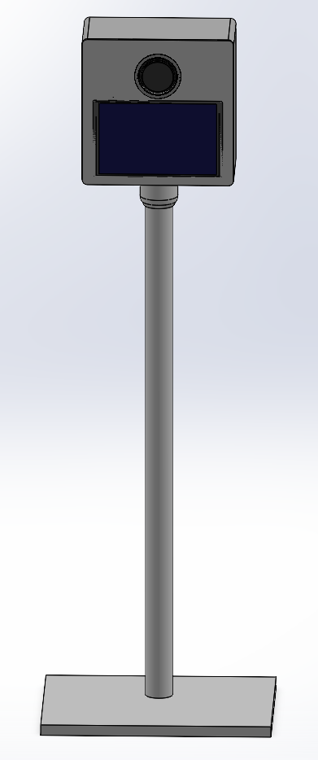
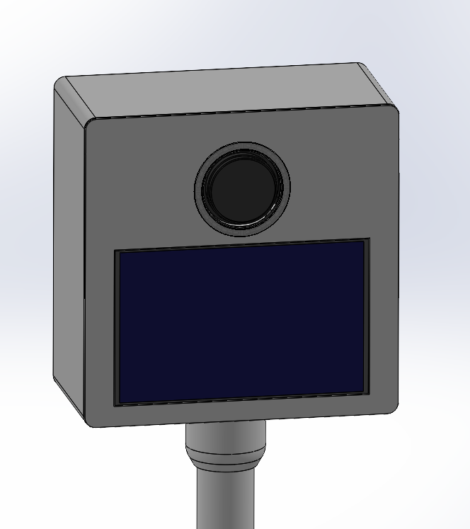
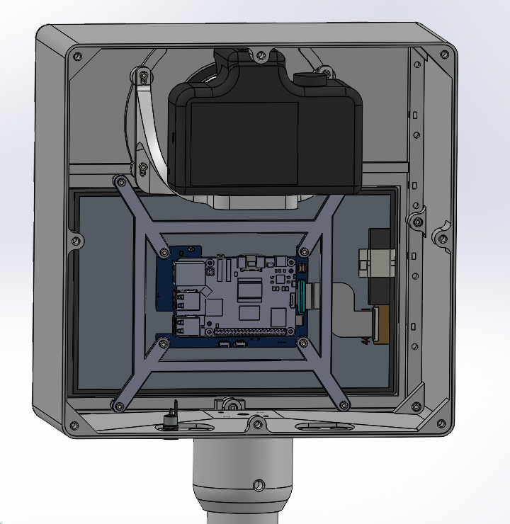
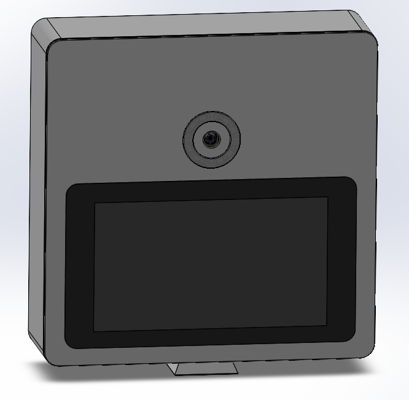
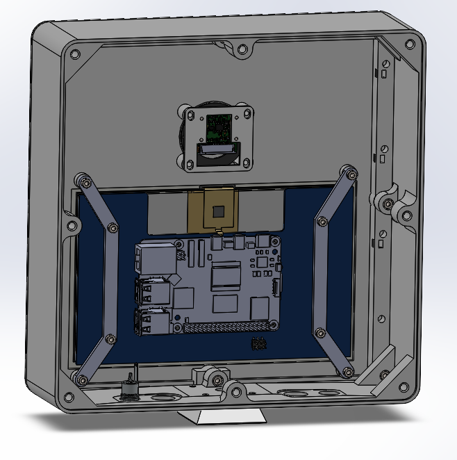
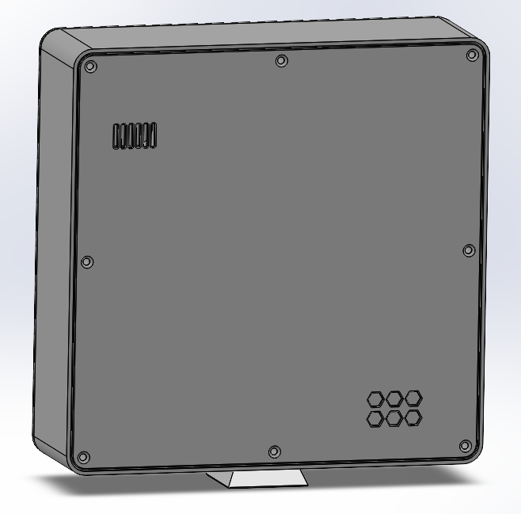

# Parametric Box

The parametric design was first released in 2024.
The design was [hosted on Github earlier](https://github.com/photobooth-app/photobooth-3d),
but moved to this site to bundle all designs in one place.

{ width="400" }

/// caption
3d printed photobooth
///

## :heart_eyes: Features

- Compact design
- DSLR and picamera variants
- Led ring signaling countdown, record and capture using WLED
- 7" or 10" touchscreens supported

## Variants

### Variant in depth

There are two different depth variants:

- higher depth for DSLR
- lower depth for Pi camera setups.

### Variant in width

There are two different width variants:

- wide that allows for 10" screens
- narrow that allows for 7" screens only

### Download model

The recommended variants are provided as STEP file for direct 3d printing.
STEP files can be imported in the Slicer and split into single objects before printing.

| Camera    | Width  | Depth | Screen                                                             | STEP file                                                                                             |
| --------- | ------ | ----- | ------------------------------------------------------------------ | ----------------------------------------------------------------------------------------------------- |
| Pi Camera | narrow | short | [7inch DSI LCD (C)](https://www.waveshare.com/7inch-DSI-LCD-C.htm) | [booth-100-000_picam-7inch](/cad/2024_7-10inch_picamera-dslr/v2/step/booth-100-000_picam-7inch.zip)   |
|           | wide   | short | [10.1DP-CAPLCD](https://www.waveshare.com/10.1dp-caplcd.htm)       | [booth-100-000_picam-10inch](/cad/2024_7-10inch_picamera-dslr/v2/step/booth-100-000_picam-10inch.zip) |
| DSLR      | narrow | deep  | [7inch DSI LCD (C)](https://www.waveshare.com/7inch-DSI-LCD-C.htm) | [booth-100-000_dslr-7inch](/cad/2024_7-10inch_picamera-dslr/v2/step/booth-100-000_dslr-7inch.zip)     |
|           | wide   | deep  | [10.1DP-CAPLCD](https://www.waveshare.com/10.1dp-caplcd.htm)       | [booth-100-000_dslr-10inch](/cad/2024_7-10inch_picamera-dslr/v2/step/booth-100-000_dslr-10inch.zip)   |

If you want to modify the model, download the [Solidworks files](/cad/2024_7-10inch_picamera-dslr/v2/solidworks/booth-100-000.zip).

## :wrench: Material (BOM)

- Touchscreen:
    - 7": [7inch DSI LCD (C)](https://www.waveshare.com/7inch-DSI-LCD-C.htm) (DSI)
    - 10": [10.1DP-CAPLCD](https://www.waveshare.com/10.1dp-caplcd.htm) (HDMI)
- RGB-LED Ring:
    - for Raspberry cameras: [5V RGB LED Ring WS2812B, outer diameter 38mm inner diameter 27mm](https://www.amazon.de/gp/product/B07TZK9DNT/ref=ppx_yo_dt_b_asin_title_o01_s00?ie=UTF8&psc=1)
    - for DSLR: [24 Bits WS2812 5050 RGB LED Ring](https://www.amazon.de/gp/product/B07DKJ6SFR/ref=ppx_yo_dt_b_search_asin_title?ie=UTF8&psc=1)
- Threaded inserts: [threaded inserts](https://www.amazon.de/VIGRUE-Gewindeeinsatz-Einpressmutter-Gewindebuchsen-Kunststoffteiledurch/dp/B08DHYD73Q/)
- Exhaust cooling fan: any 30x30 5v fan
- DC jack
- Sortiment of M2 and M3 screws DIN912
- Sortiment of tapping screws DIN 7049 ST2 to ST3

Above are the parts that are hard required by the mechanical design.
Of course you need to add your Raspberry Pi or alternative computer and the camera depending on your setup.

## :camera: CAD images of the box

{ width="400" }
{ width="400" }
{ width="400" }
{ width="400" }
{ width="400" }

## :screwdriver: Assembly

Unfortunately, there is no dedicated assembly description available. The design is provided as is. Best is to explore the design in a CAE tool prior printing. If you have specific questions, feel free to ask in the [GitHub discussions](https://github.com/photobooth-app/photobooth-app/discussions).

## :mag: Changelog / Archive

- v2 release 2024-09-13
    - reworked solidworks model
    - reinforced lower side in frame part
    - split front and side frame so it can be printed in different colors easily.
- rc2 facelift 2024-09-05
    - overall size changed, not compatible with former version.
    - backplate including cooling
    - simplified design
    - prepared for quality touchscreens from waveshare to enhance reliability
- rc1 (2022-10-03)
    - introduced led ring
    - improved assembly and strength
    - camera mount improved and allows for alignment while assembling
- prototype
    - first version for testing and design improvements
