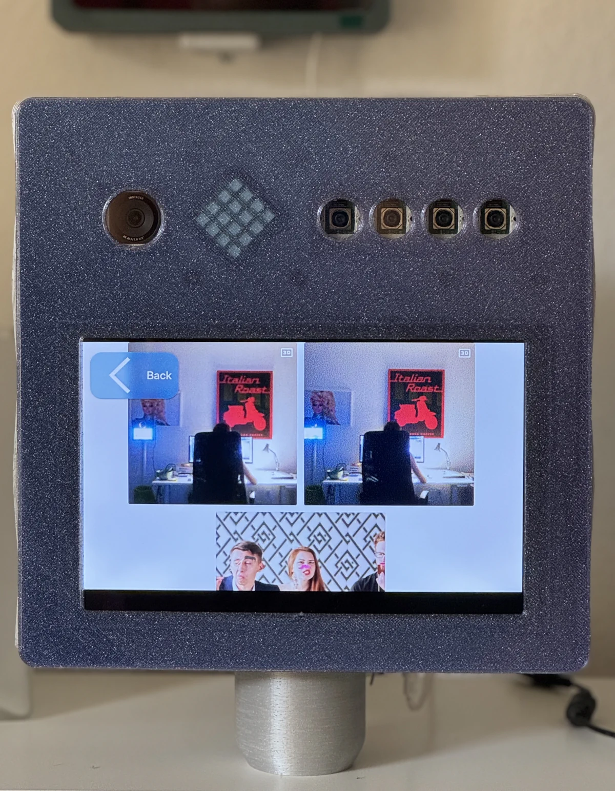
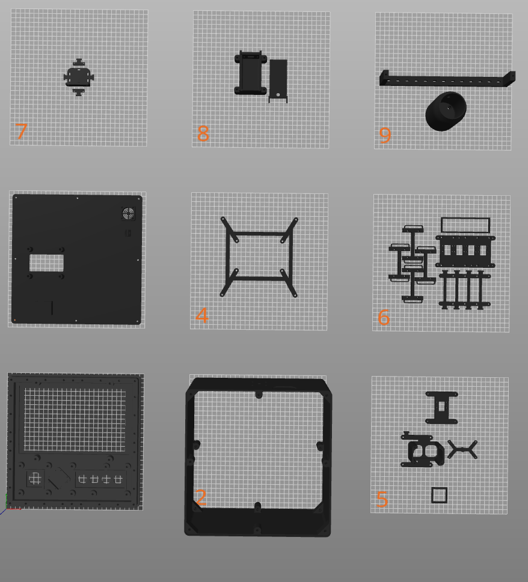
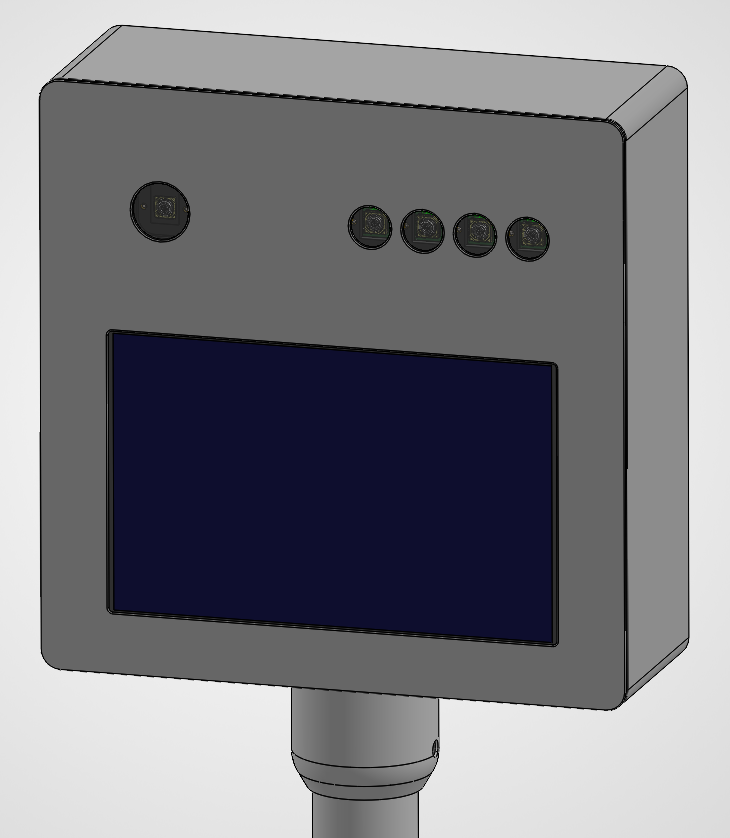
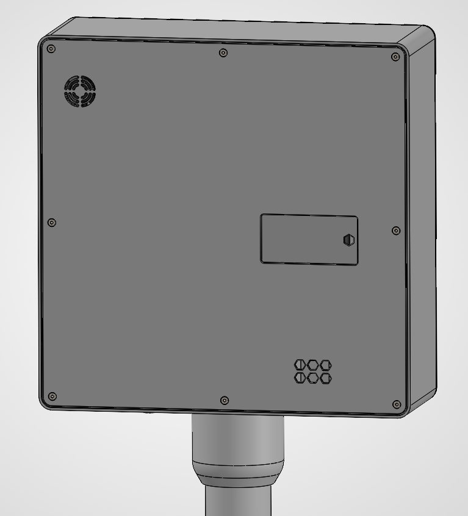
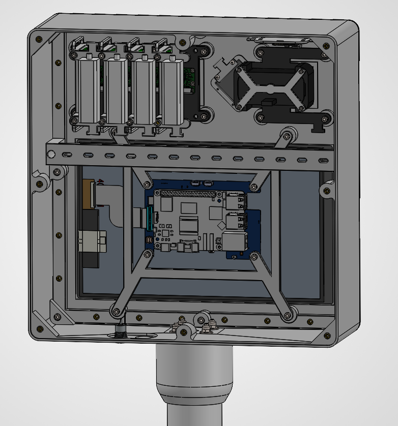

# WiggleCam Box

The wigglecam box design was first released in 2026.
It is based on the prior design but only supports the larger 10" screen.

{ width="400" }

/// caption
3d printed photobooth box to build a wigglecam
///

## :heart_eyes: Features

- Webcam and Raspberry Pi Camera mounts for high quality stills
- 4 Pi Camera Modules v3 arranged in a group to capture [wigglegrams](/wigglegramcamera/).
- WLED matrix module signaling countdown and captures. The led matrix displays an arrow of the camera currently active.
- 10" touchscreen

### Download

Current release files available:

- [Solidworks CAD model](/cad/2026_10inch_wigglecam/rc3/solidworks/booth-000-rc3.zip)
- [STEP file](/cad/2026_10inch_wigglecam/rc3/step/booth-000-rc3.zip) to import in any CAD tool or the slicer
- [3mf file](/cad/2026_10inch_wigglecam/rc3/print/booth-000-rc3.zip) to start printing right away.

Earlier revisions are available in the archive down below.

## :wrench: Materials (BOM)

Components:

- Camera: Insta 360 Link 2C, Insta 360 Link 2C Pro or Pi Camera Module v3
- 10" screen [Waveshare 10.1DP-CAPLCD](https://www.waveshare.com/10.1dp-caplcd.htm)
- Raspberry Pi 4 / 5
- WiggleCam Assembly: 4 x Pi Camera Module v3, 4x Pi Zero 2W, 4x MicroUSB Ethernet Adapter
- USB Type A - panel mount
- Bauer Electronics DC-DC SPW-1224V0510 (to supply the 5V components from 24V avoiding ac current in the box)
- Teltonica 5port Ethernet Switch TSW010

Other:

- DC jack
- Sortiment of M2 and M3 screws DIN912
- Sortiment of tapping screws DIN 7049 ST2 to ST3
- Axial Fan 30x30
- Led Matrix 5v RGB
- M2-4-3,2 heatinsert
- M3-5,7-4,6 heatinsert

## How to print

{ width="400" }

1. Front Plate
2. Frame
3. Rear Plate
4. Screen Mount
5. Main camera mounts
    - Top: Pi Camera v3
    - Middle: Insta Link 2C (Pro)
    - Bottom: Mount to fix a PMMA cover
6. WiggleCam assembly group
7. WLED module mount
8. Rear mounted module for USB thumb drives
9. Mount for a stand and a bridge to tie cables to

## :camera: CAD images of the box

{ width="400" }
{ width="400" }
{ width="400" }

## :mag: Changelog / Archive

- rc3 release 2026-05-02
    - initial release of the revised legacy box including wigglecam assembly
- prior rc3 releases
    - never released, only for internal testing and improving
