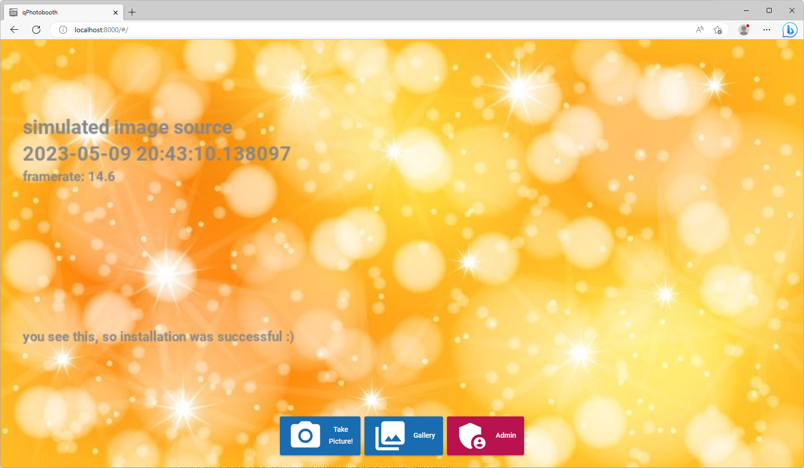
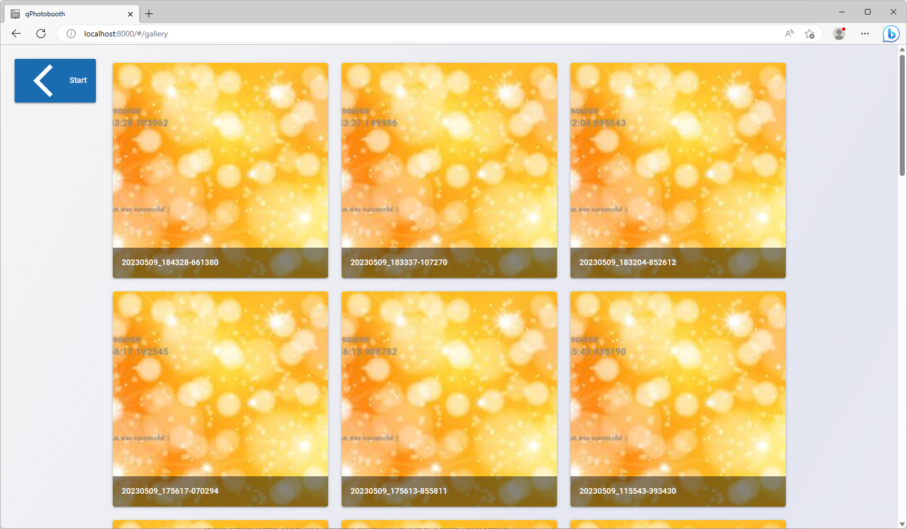
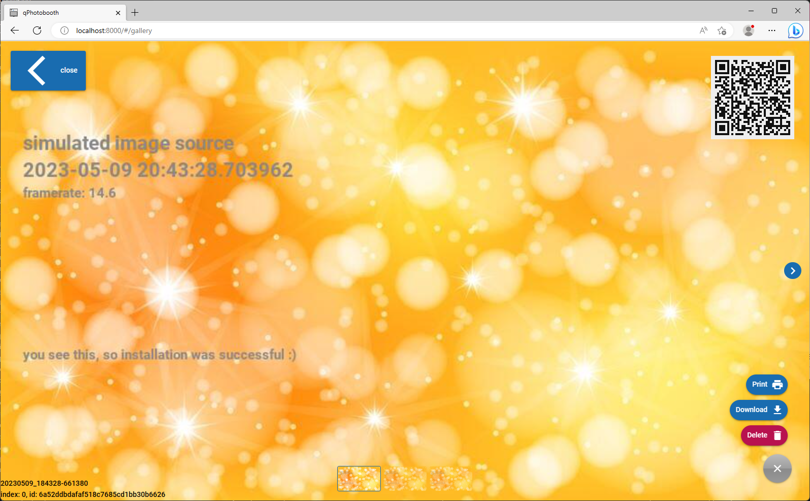
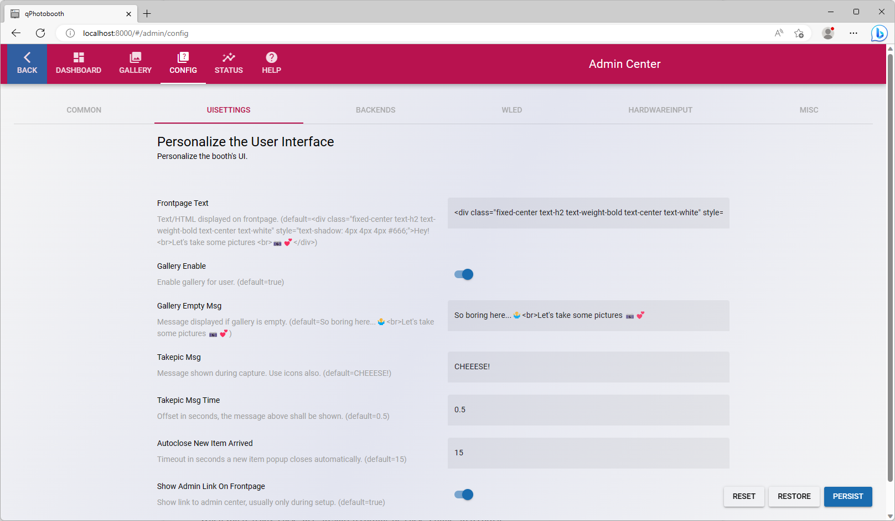
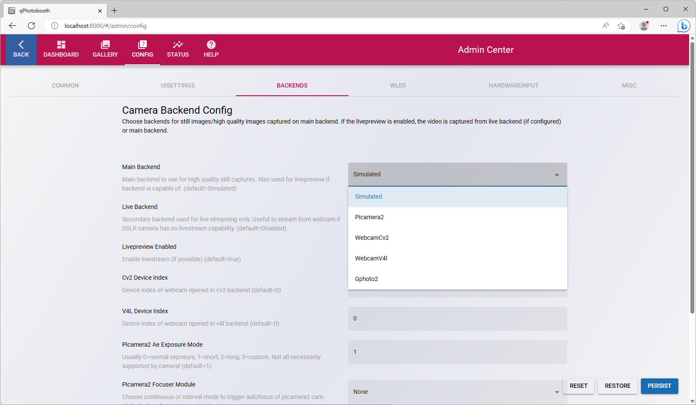
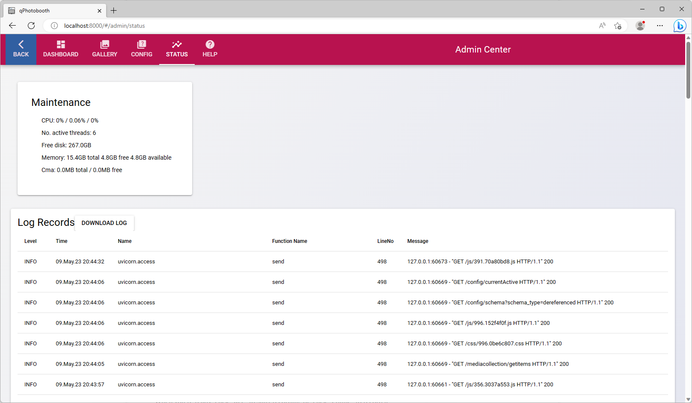

# Screenshots

<figure>
  
  <figcaption>Frontpage of the photobooth-app showing the livestream</figcaption>
</figure>

<figure>
  
  <figcaption>List images in the gallery</figcaption>
</figure>

<figure>
  
  <figcaption>View image in the gallery</figcaption>
</figure>

<figure>
  
  <figcaption>Easy to configure your photobooth in config dashboard</figcaption>
</figure>

<figure>
  
  <figcaption>Several camera backends supported depending on your OS.</figcaption>
</figure>

<figure>
  
  <figcaption>View latest logs and status information in the admin panel</figcaption>
</figure>
