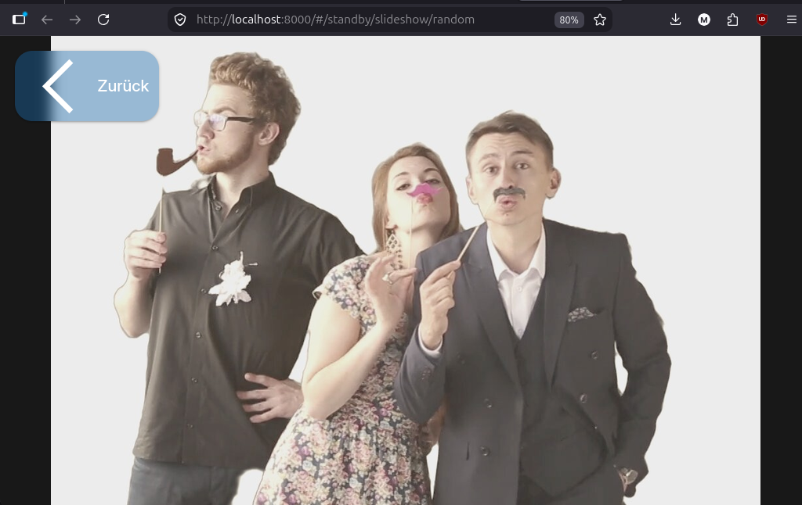

# Landing Pages

## Standalone Gallery

If you need a second screen for users to browse the gallery, this standalone gallery URL shall be a good entry point.
It will not allow to escape the gallery as there is no button to return to frontpage.

<video controls loop muted autoplay >
  <source src="./assets/landingpage-standalone-gallery.mp4" type="video/mp4" />
</video>

→ `http://IP:8000/#/standalone/gallery`, example <http://localhost:8000/#/standalone/gallery>

## Standalone Slideshow

Random slideshow to be used on second display in standalone mode. It will not allow to escape the gallery, there is no button to return to frontpage.

<video controls loop muted autoplay >
  <source src="./assets/landingpage-standalone-slideshow.mp4" type="video/mp4" />
</video>

→ `http://IP:8000/#/standalone/slideshow`, example <http://localhost:8000/#/standalone/slideshow>

## Slideshow on Inactivity

After a configurable timeout a slideshow is automatically started. There is a button to stop the random slideshow so users can start using the photobooth again.
While the photobooth is inactive, the livestream is stopped and the camera is set to standby also. This saves energy and avoids overheating the camera's sensor.

→ `http://IP:8000/#/standby/slideshow/random`, example <http://localhost:8000/#/standby/slideshow/random>
