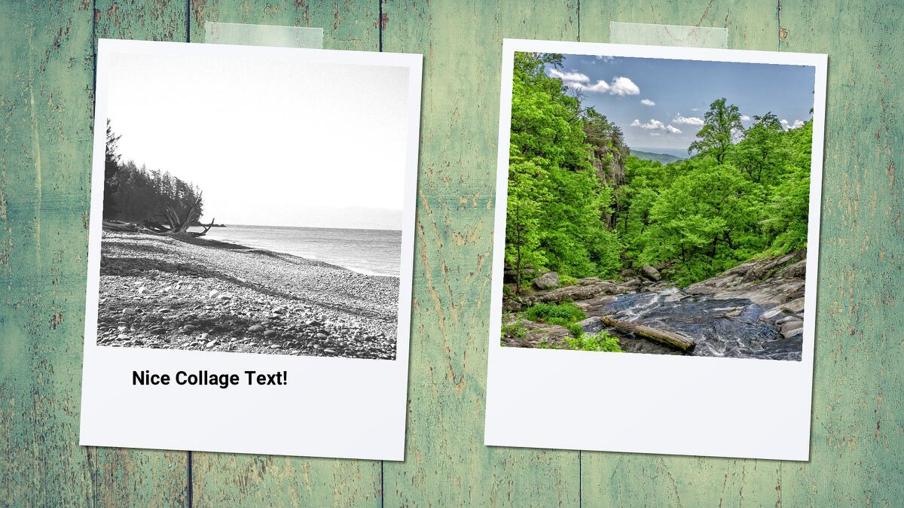
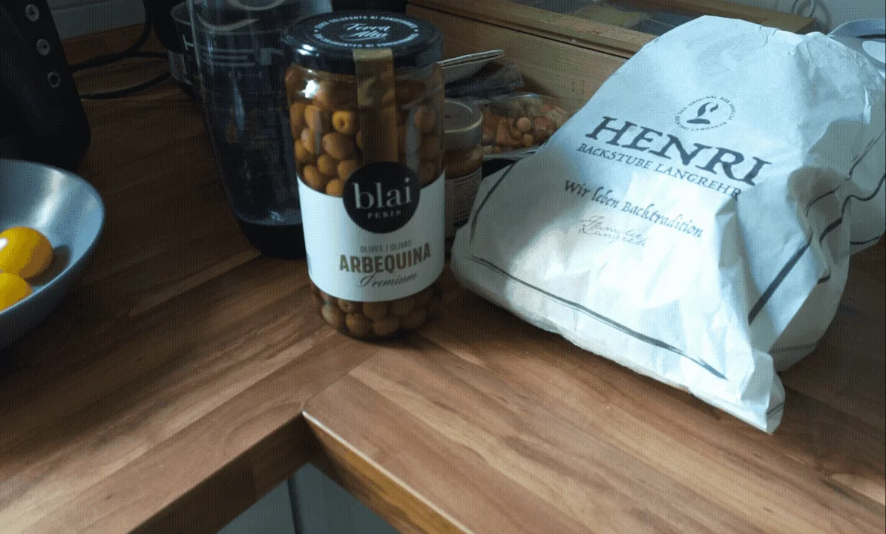

# Actions and Trigger

The photobooth-app offers different modes to capture:

- Single images,
- Collages,
- Animations,
- Videos and
- Multicamera 3d-wigglegrams.

Each action can be triggered by one or more of the following triggers:

- Touch buttons on the main screen of the app (frontpage),
- GPIO pins on a Raspberry Pi,
- Keyboard input or
- via your custom solution that calls the actions on the [Rest-API endpoints](../../reference/api.md).

## Actions

### Single Images

Single images are captured stills in one shot.

The image can be modified, eg. add a new frame on top of the image and some custom text like in the example below.
Also, the background can be removed using an AI algorithm and replace it by an image.

### Collages

Collages are compiled from several images. These can mix of captured images from the camera and predefined images.
Each capture can be modified, eg. remove the background and fill it with a solid color before merging it in the collage.
Following is an example for a collage with two captures (left/right) and a predefined image in the center.

### Animations

The animations are burst captures of several images and replayed like a GIF. It's also possible to use predefined images that are embedded in every animation instead a capture. You can apply a frame and add texts to the final image as well as a color-filters.

### Videos

Videos (no sound unfortunately, yet) can be captured from the livestream. After capture there is an option to generate a boomerang effect video.

### Multicamera 3D Wigglegrams

This very unique feature allows to capture a scene from multiple cameras at the same time. The result is a wigglegram, see the [separate section for more details](../../wigglegramcamera/index.md).

## Trigger

### Touch buttons on the screen

To display a trigger button on the main screen of the app, define in the trigger section of an action a title and/or an icon.
The icon can be any material design icon.

### GPIO

To trigger an action via GPIO define the pin and choose when to trigger the action (on press, on release or after hold).

::: info
Enable the GPIO service in admin dashboard -> configuration -> hardwareinput/output!
:::

::: warning
Each pin can be used only one time! Check the log for errors if it does not work as expected.
:::

[See the GPIO section how to wire the buttons](./gpio.md).

### Keyboard

To trigger an action via keypress define the keycode. If you're unsure what keycode to use, open the browser console and press the key to check for the keycode. The keycodes are captured by the browser.

::: info
Enable the keyboard processing in admin dashboard -> configuration -> hardwareinput/output!
:::

## Questions remain?

Reach out in a [discussion](https://github.com/photobooth-app/photobooth-app/discussions).
