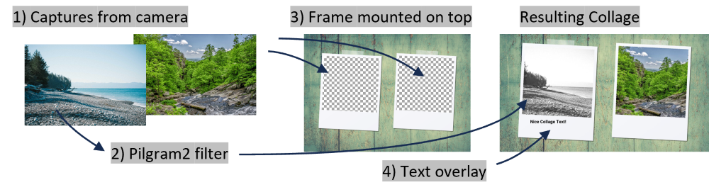

# Post-Processing Captures

When all captures of the action (like normal capture, collage, animations, etc) have been completed, the media is post-processed. Every action offers additional settings to adjust the post-processing to your needs. During finalization, the app applies all steps consecutively to a copy of the captures and finally the item is presented to the user. This way, the original capture always remains intact so it can be downloaded from the photobooth after the event.

## Pipelines

Each action has a predefined post-processing pipeline consisting of several predefined steps. The steps can be enabled or disabled and offer additional settings like colors, texts, fonts, etc.
The post-processing is configured per action in the admin center. Since each action has it's own settings, you can have multiple collages each themed with a different frame.

When a pixel coordinate needs to be given, the coordinate origin is top/left, so (0/0) refers to the top-left edge of an image.

### Single Image

The single image pipeline runs steps in the following sequence:

1. Background removal using AI (can remove all backgrounds and greenscreen), replace by transparency
2. Apply [pilgram2 filter (instagram like filters)](https://github.com/mgineer85/pilgram2)
3. Fill the background with a solid color
4. Add a background image. This is useful only if no solid color was added prior.
5. Overlay a frame with transparent areas. The captured image is mounted to cover the transparent area while keeping the aspect ratio. If required the capture will be cropped to match the transparent area. Use PNGs with transparency.
6. Place optional text and image overlays.
7. Apply the optional watermark to the final image.

### Collage

The collage pipeline runs steps in the following sequence:

1. Run single image steps (background removal, pilgram2, etc).
2. Merge captured images and predefined images on one canvas. In this step an additional mediaitem is generated.
3. Fill the canvas background with a solid color
4. Add a background image to the canvas. This is useful only if no solid color was added prior.
5. Place a PNG image on top. Captured images are visible in the transparent areas of the PNG.
6. Place optional text and image overlays.
7. Apply the optional watermark to the final collage, not the individual captures.

### Animations

The animation pipeline runs steps in the following sequence:

1. Run single image steps (background removal, pilgram2, etc).
2. Build a sequence of the captures and predefined images to create an animation. The animations can be exported in several fileformats like MP4, GIF, WebP, AVIF. In this step an additional mediaitem is generated.

### Videos

The videos are created from the camera's livestream. Sound is currently not supported, the default video pipeline is to create a boomerang which works well without audio.
There are basic options currently available:

1. The maximum duration of a video. The caputure process is stoppable by the user before the maximum duration is reached but will be stopped latest when the maximum duration elapsed.
2. Boomerang option enable to append the video in reverse.
3. Choose a framerate of the video.

### 3D Wigglegram-Pipeline in Multicamera Setups

The wigglegram pipeline runs steps in the following sequence:

1. Run single image steps (Pilgram2 filter currently only).
2. Build a sequence of the captures to create the wigglegram an animation. The sequence for a 4 camera array is 1-2-3-4-3-2 and then repeat. The wigglegram can be exported in several fileformats like MP4, GIF, WebP, AVIF. In this step an additional mediaitem is generated.

## Steps

### Background Removal

In v8 the previous chromakeying/greenscreen removal was replaced by a more universal AI background removal tool.
It is to remove background parts from captured images so the removed parts of the image are transparent. The now transparent areas can be filled with solid colors or other background images in subsequent steps.

### Color-Filter

Apply a default color filter. Choose from [pilgram2's available filters](https://github.com/mgineer85/pilgram2).
There is also the option for the user to change the filter in the gallery.

### Fill Background using a Solid Color

When using the background removal step, the removed background is empty and transparent. Applying this step, the transparent area is filled with a solid color.

### Fill Background using an Image

When using the background removal step, the removed background is empty and transparent. Applying this step, the transparent area is filled with an image.

### Frame Image Overlay

Images captured can be overlaid by a frame. For this step you provide a PNG with transparent area. The captured image will be mounted to the frame covering the transparent area while keeping the aspect ratio. The transparent area is automatically detected by the app. If the aspect ratio of the captured image and the transparent area are very different, large parts of the captured image are cropped.

### Texts

Texts that are overlaid the finished image. Use it to easily individualize the images without having to create a new background images where a picture would get inserted to. Custom fonts are supported.

### Watermark

Image and collage actions can overlay a watermark as the final processing step. Select an image from `userdata`, preferably a PNG with transparency. The watermark is centered and scaled to the final image while preserving its aspect ratio: **cover** fills the image and may crop the watermark, while **contain** shows the entire watermark and may leave space around it. The original capture remains unchanged.
