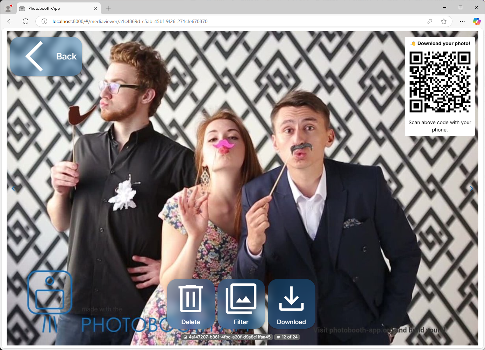
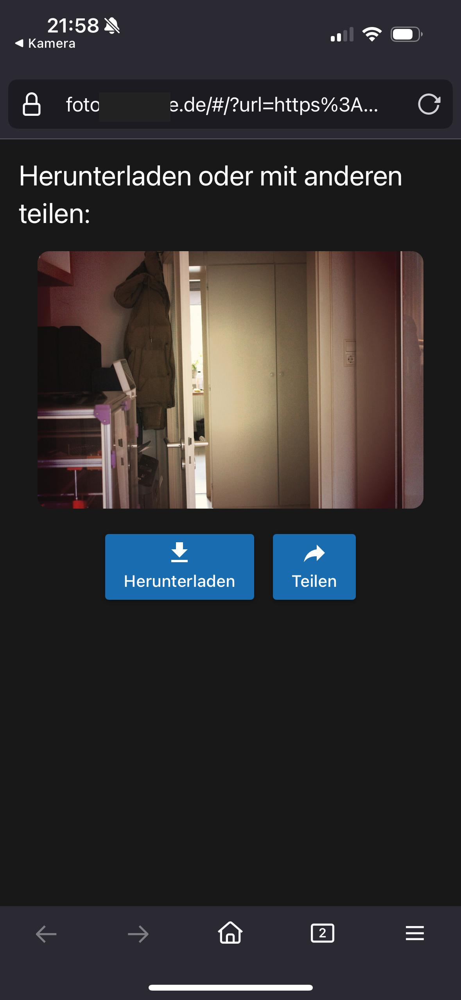
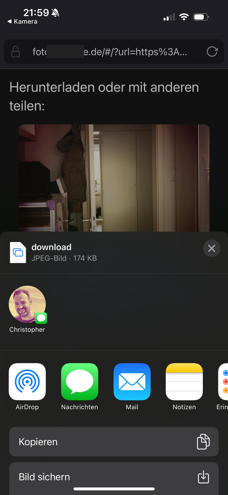
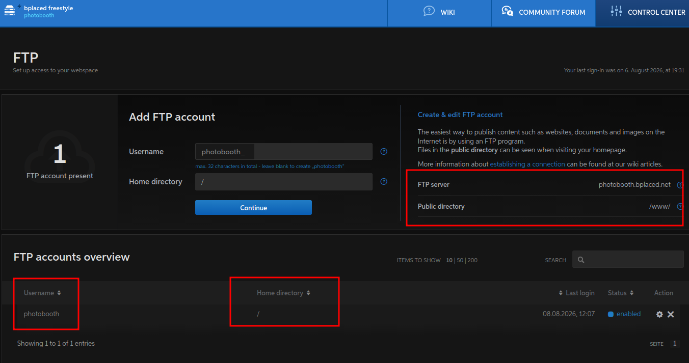
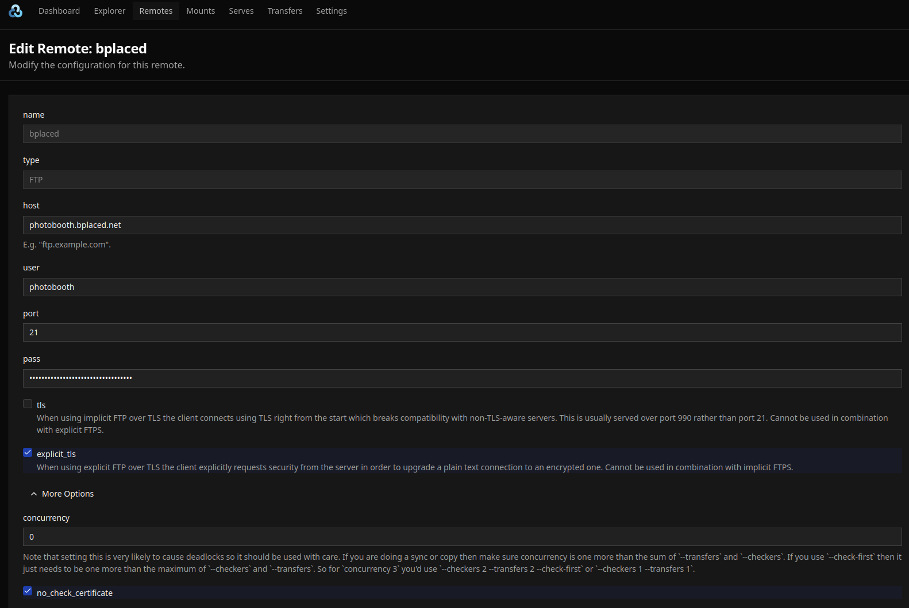
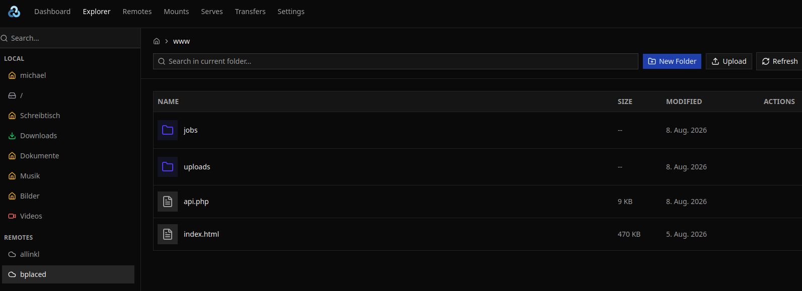
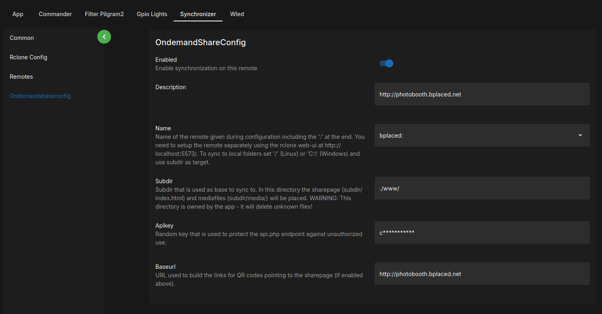
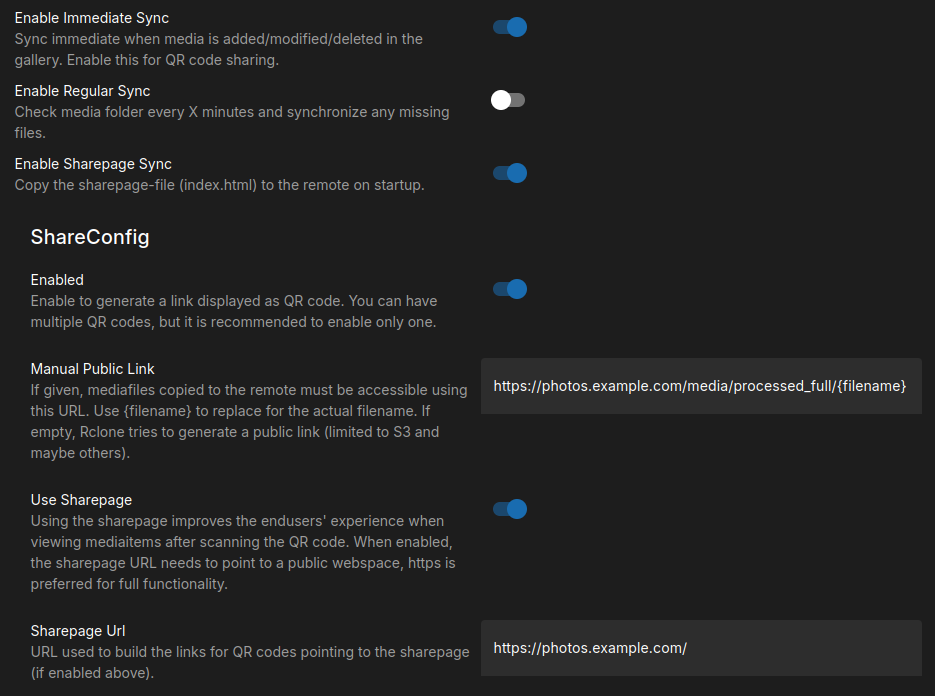
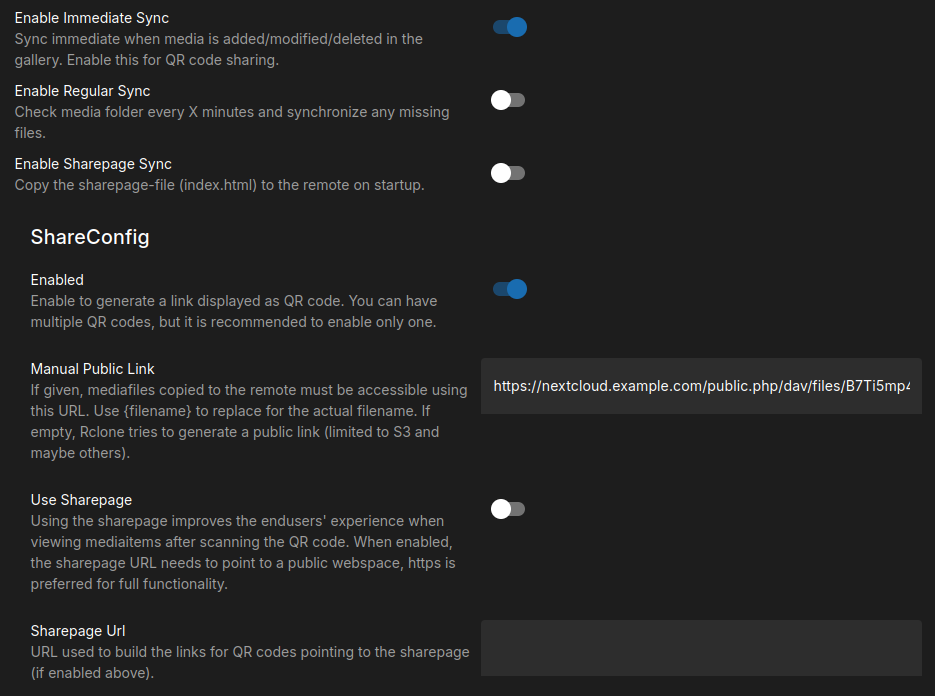

# Share using QR Codes

QR codes are a convenient way for users to download their photos to their personal devices.
The QR code points to a HTTP server either online or provided by the photobooth-app itself in the local network.

!!! info

    The description is valid for v9 and later. For older versions, please see the former, deprecated [synchronization tool description](./synchronizelegacy.md).


<figure markdown>
  { width="500" }
  <figcaption>Users scan the QR code to download the displayed image on their mobile.</figcaption>
</figure>

The QR code could point directly to the image or to a sharepage embedding the image.
When using the sharepage, a bold share button is displayed next to the image.
Using the sharepage might be more convenient for endusers because sharing to social media and messaging apps is very easy.

<p style="display: flex;  justify-content: center; gap: 10px;">
  
  
</p>
<figcaption style="text-align: center;">The sharepage with a media file being displayed on the endusers phone (left) and the phones native share menu (right).</figcaption>

The sharepage is just one single [HTML page](https://github.com/photobooth-app/photobooth-app/tree/main/src/web/sharepage) and basically a loader for the media files.
To use it, the HTML page needs to be hosted on a webserver that is accessible from the internet.
Due to security reasons, the HTML page needs to be located on the same host as the media files.

## Options to provide media files

For QR code sharing, a prerequisite is to make the media files available online. The files need to be accessible from the public internet so they can be downloaded on the smartphones of the endusers.
The Synchronizer with Rclone under the hood is used to upload files to many storage providers. For a complete [list of rclone's supported cloud storage systems](https://rclone.org/overview/) check their website.

Following overview might help you to decide, which way to go. In doubt? [Start a discussion](https://github.com/photobooth-app/photobooth-app/discussions).

| Option                  | A) Share On Demand using Synchronizer                                                                                                                                                                                                            | B) Full Sync Share using the Synchronizer                                                                                                      | C) Your custom solution                                                                                   |
|-------------------------|--------------------------------------------------------------------------------------------------------------------------------------------------------------------------------------------------------------------------------------------------|------------------------------------------------------------------------------------------------------------------------------------------------|-----------------------------------------------------------------------------------------------------------|
| Description             | QR codes point to a online hosted PHP script on a shared webspace. When a QR code is scanned, only the requested file is uploaded on the fly.<br>Since only requested files are uploaded the data usage is lower than with the full sync method. | Generate QR codes pointing to the media files hosted online. All media files are uploaded immediately.                                         | Share via local WiFi-Hotspot                                                                              |
| Pros                    | ➕ Automatic immediate sync<br>➕ Quite simple setup<br>➕ Convenient for users<br>➕ Lowest data usage                                                                                                                                              | ➕ Automatic immediate and time-interval synchronization<br>➕ Quite easy setup<br>➕ Convenient for users<br>➕ Could be used as immediate backup | ➕ No need to synchronize<br>➕ No issues if internet service is bad<br>➕ Less likely to conflict with GDPR |
| Cons                    | ➖ The QR codes are only valid as long as the photobooth is operating<br>➖ Internet service might fail any time<br>➖ Images shared via (private) internet service might conflict with GDPR                                                                                                                                | ➖ Internet service might fail any time<br>➖ Images shared via (private) internet service might conflict with GDPR                              | ➖ Inconvenient for user: Smartphones need to log in local WiFi<br>➖ Custom setup                          |
| Prerequisites           | Online hosting service with PHP and FTP access to deploy the PHP script, [synchronization is setup using Rclone](./synchronize.md)                                                                                                               | Online hosting service that is supported by Rclone, [synchronization is setup using rclone, see separate setup](./synchronize.md)              | WiFi Hotspot                                                                                              |
| Connectivity            | Online, Internet required.                                                                                                                                                                                                                       | Online, Internet required                                                                                                                      | Offline, no Internet required                                                                             |
| Complexity for endusers | Simple                                                                                                                                                                                                                                           | Simple                                                                                                                                         | Complex, users need to access the local WiFi                                                              |
| Complexity to setup     | Simple-Medium                                                                                                                                                                                                                                    | Medium, need to setup Rclone                                                                                                                   | Advanced                                                                                                  |


## Option A: Share on Demand QR codes

In the following tutorial, we setup the on-demand service using [bplaced.net freestyle hosting](https://www.bplaced.net/freestyle). Feel free to choose a different provider that has FTP and PHP available.


### Hosting Services

The hosting service needs to offer following services to work properly:

  - PHP 8
  - FTP Server to upload the PHP files automatically
  - NO Bot detection (usually only free services, infinityfree doesnt work for this reason)
  - Optional: TLS/SSL (needed to display the "Share" button, this is a browser restriction)

Usually, all paid shared webhosts should fulfill these basic requirements. Free services can be unreliable. In the examples below, we use bplaced.net as it is fast to setup and has all features, except SSL unfortunately. If you know a better simple to setup hosting service, please let me know.

### Setup Share on Demand

After registering for the bplaced free-tier service, you need to setup the FTP server as remote in Rclone.



Check the details in the bplaced FTP dashboard for the credentials, the above screenshot is an example we configure now.

Ensure the app is started and the synchronizer plugin is enabled. Also check that the WebUI for rclone is enabled.
Now open the Rclone WebUI, it should be accessible from the same device at the following link [http://127.0.0.1:5573/login?url=http://127.0.0.1:5572](http://127.0.0.1:5573/login?url=http://127.0.0.1:5572).

Go to the `Remotes` tab and create a new remote. The settings should look similar to below screenshot.



Once the remote is created, in the tab `Explorer`, you can choose the remote and browse the files. Ensure the remote can be opened properly. The directly might be empty or have some preinstalled files in the folder listed.



When the Rclone connection is confirmed to work properly, go to the photobooth Admin Dashboard - Configuration - Synchronizer.

Configure the newly created remote to be used for the On-Demand Share as depicted in below screenshot. 
For bplaced, the subdir `./www/` needs to be chosen, as that directory is served publicly.



Click Save and Apply - check the log messages during the reload. The app tries to install the api.php and index.html automatically for you.
Normally the log should look like this during startup:

```txt
2026-08-08 11:50:22,883 [    INFO] Access Rclone using the following link http://0.0.0.0:5573/login?url=http%3A%2F%2F127.0.0.1%3A5572 (api.py:68)
2026-08-08 11:50:22,883 [    INFO] rclone started, cmd=/home/michael/Dev/photobooth/photobooth-app/.venv/lib/python3.14/site-packages/rclone_api/bin/rclone gui --addr=0.0.0.0:5573 --no-auth --no-open-browser --api-addr=127.0.0.1:5572 --rc-no-auth --rc-allow-origin=* --config=config/rclone.conf --log-file=log/rclone.log --log-level=NOTICE --transfers=4 --checkers=4 (api.py:107)
2026-08-08 11:50:23,000 [    INFO] rclone is operational now (api.py:114)
2026-08-08 11:50:23,001 [   DEBUG] ShareOnDemandService-resilient service starting (resilientservice.py:162)
2026-08-08 11:50:23,001 [    INFO] starting ShareOnDemand worker_thread (shareondemand.py:116)
2026-08-08 11:50:23,001 [   DEBUG] ShareOnDemandService started using endpoint baseurl http://photobooth.bplaced.net. (shareondemand.py:53)

```

And whenever a QR code is scanned, the request is logged:
```

2026-08-08 12:29:40,368 [   DEBUG] generating shareondemand qr links for f2cc8a97-7539-424d-bffe-3a2c471b6a5b (shareondemand.py:103)
2026-08-08 12:29:45,662 [   DEBUG] got upload job, id f2cc8a97-7539-424d-bffe-3a2c471b6a5b (shareondemand.py:171)
2026-08-08 12:29:45,712 [    INFO] Uploading <Mediaitem> (20260808-090647-566475.jpg) (shareondemand.py:185)
2026-08-08 12:29:45,908 [   DEBUG] upload took 0.2s, answer from server: {"detail":"ok","type":"message"} (shareondemand.py:213)

```

If there are issues, please go to Github discussions to research or post an issue.


## Option B: Full Sync QR codes


To make the media files downloadable using a QR code, the [files need to be synchronized prior download](./synchronize.md). Please ensure the synchronization is setup properly beforehand and turn on `enable immediate sync` to upload the media files right after the capture.

Depending on the storage type you use, the sharepage is a good addition or not. If the storage type has it's own frontend, like NextCloud, Google Photos and similar you probably do not want to setup the sharepage but point the QR code directly to the image URL.
If there is no frontend, like for FTP or S3 buckets, the sharepage is a good addition.

Please follow one of the next chapters for a reference with/without sharepage.

### Setup using the Sharepage (Example using FTP)

Please configure the rclone remote as follows:

- `enable immediate sync` true, to upload the media files right after the capture.
- `enable sharepage sync` true, so the sharepage is created and updated as needed on every app startup on the remote.
- In the ShareConfig section:
    - `enabled` true, so this remote is generating a QR code when requested.
    - `manual public link` set to the URL which points to the mediafile on the server. `{filename}` is replaced by the filename when generating the link.
      Example: If the FTP server synchronized to is `ftp.example.com` and a webserver serves the same folder uploaded on `https://photos.example.com`, you set the public link to `https://photos.example.com/media/processed_full/{filename}`. The media folder is created during synchronization automatically.
    - `use sharepage` true, so the QR code points to the sharepage configured in next step instead displaying only the image.
    - `sharepage url` set to the URL which points to the sharepage on the server. The sharepage needs to be on the same host, which is automatically true if the sharepage is synchronized automatically (`enable sharepage sync`). Usually the URL is the base of the host, so in this example `https://photos.example.com`.



### Setup without Sharepage (Example using NextCloud)

Please configure the rclone remote as follows:

- `enable immediate sync` true, to upload the media files right after the capture.
- `enable sharepage sync` false, since there is no way to serve the HTML file using NextCloud.
- In the ShareConfig section:
    - `enabled` true, so this remote is generating a QR code when requested.
    - `manual public link`: Rclone does not support automatic link creation for NextCloud (WebDAV). You need to create a share link in the NextCloud filemanager and concatenate the link manually for further use.
      Example: The NextCloud share-link is `https://nextcloud.example.com/index.php/s/B7Ti5mp4JtYpktP` and allows for public display of the folders content. This translates to a public link as follows: `https://nextcloud.example.com/public.php/dav/files/B7Ti5mp4JtYpktP/media/processed_full/{filename}`. Please note to replace the share-id in the example link!. `{filename}` is replaced by the filename when generating the link. The media folder is created during synchronization automatically.
    - `use sharepage` false, so the QR code points directly to the manual public link.
    - `sharepage url` is not used.



## Option C: Your custom solution

If the synchronizer plugin is not what you want, you could deploy your own solution.
For example create a local WiFi that allows user access to the photobooth.
Users log in that WiFi and can download directly from the photobooth without internet services.
Setup the URL for the QR code to point to the image you would like to let the user download.
There are several versions of the images available, see the [list of mediaitem's directories](../../reference/foldersandurls.md#mediaitems).

Below an example URL to use in the QR code. {identifier} gets replaced by the actual filename. Replace the IP and port by the actual data.

Custom solutions are out of scope of the documentation. You need to figure out a way to make the media files accessible.
Then configure the QR code custom URL to point to the corresponding URL.

Setup:

- Admin Dashboard → Synchronizer → Common
  - → Enabled Share Links `true`
  - → Enabled Custom Qr Url `true`
  - → Custom Qr Url set to your custom URL serving the media e.g.: `http://michael-MINIPC:8000/sharepage/#?url=http://michael-MINIPC:8000/media/full/{identifier}`. The default value should work on your network already as it is generated for you automatically based on the computers hostname.
